<div align="center">

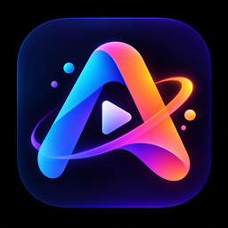

# Astrix Studio

**Animación 2D con huesos, edición de video y vectores con IA, todo en el navegador.**

Lee y guarda archivos `.moho` · Claude como motor creativo · Seedance, FLUX, Recraft (fal.ai) · Voces de ElevenLabs · Investigación de tendencias con Apify · Medición UTM · Multiusuario con MariaDB

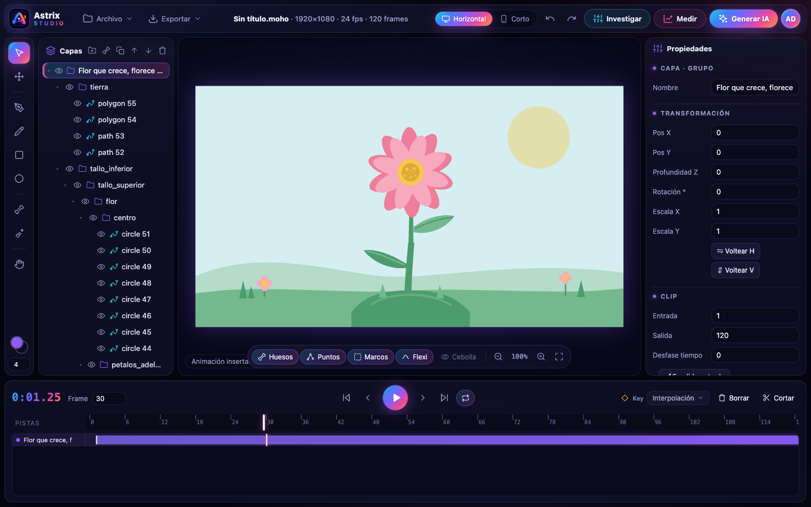

</div>

---

## Capturas

| | |
|---|---|
| 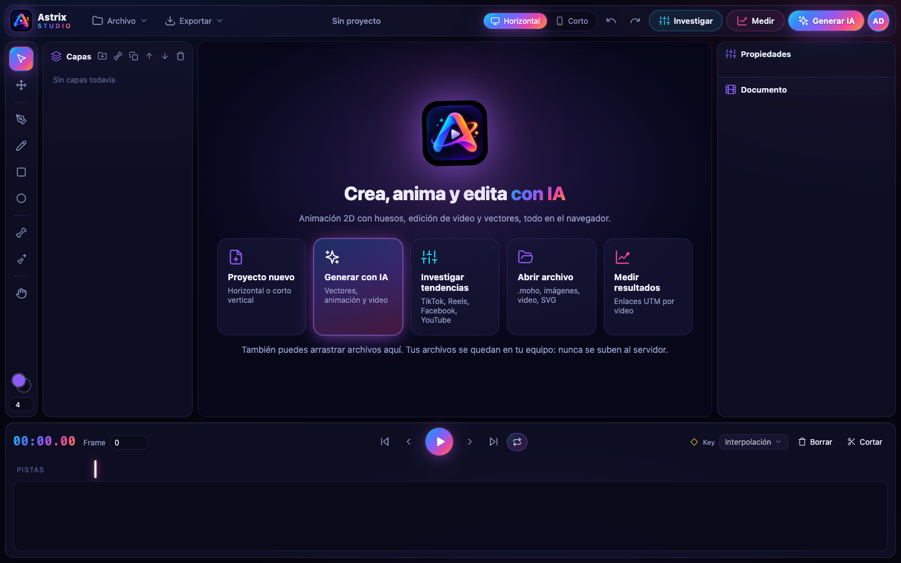 **Bienvenida** con acciones directas | 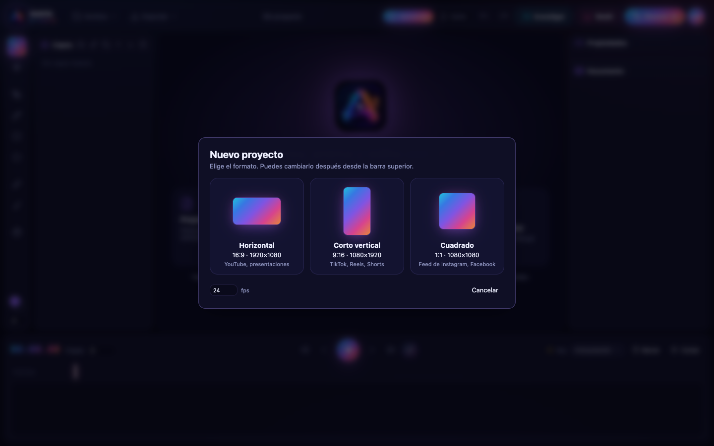 **Formato del proyecto**: horizontal, corto vertical o cuadrado |
| 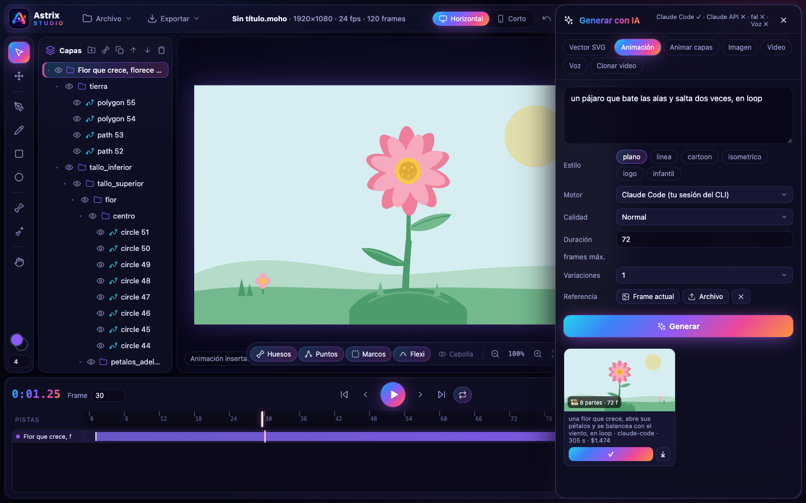 **Asistente de IA**: SVG, animación, imagen, video, voz | 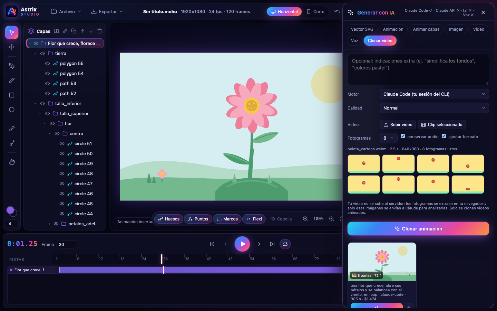 **Clonar video animado** desde fotogramas extraídos en tu navegador |
| 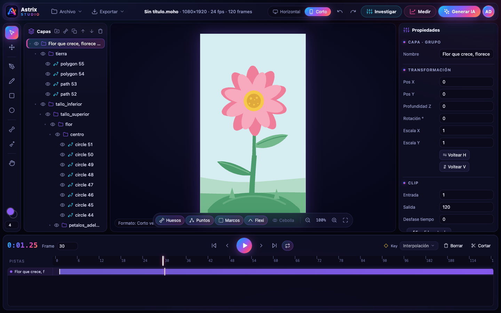 **Formato corto 9:16** para TikTok, Reels y Shorts | 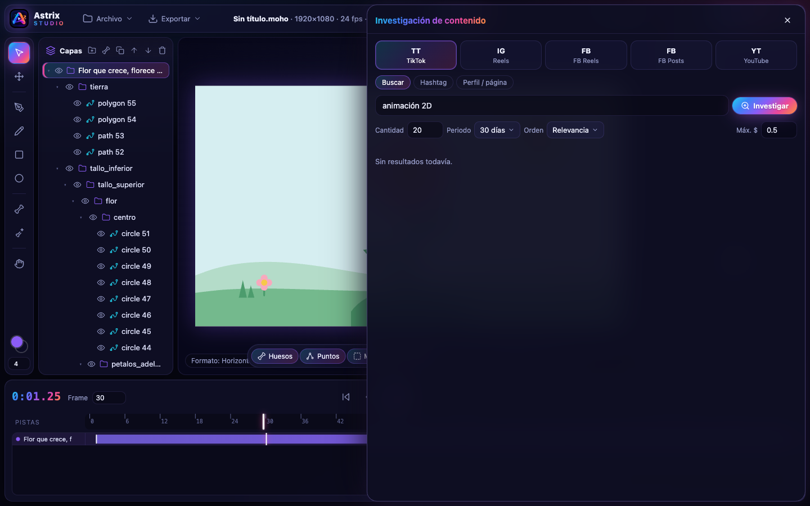 **Investigación de contenido** en TikTok, Reels, Facebook y YouTube |
| 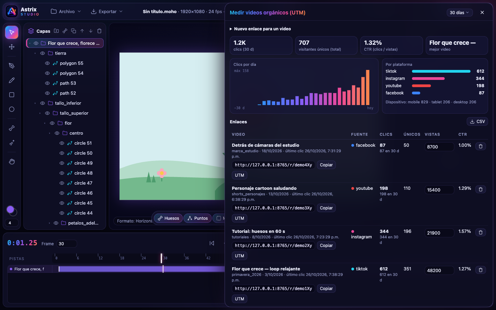 **Medición UTM** de videos orgánicos (datos de demostración) | 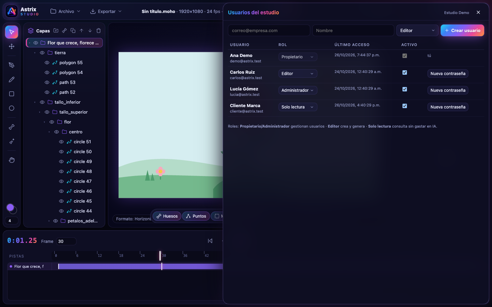 **Usuarios y roles** por estudio (multitenant) |
| 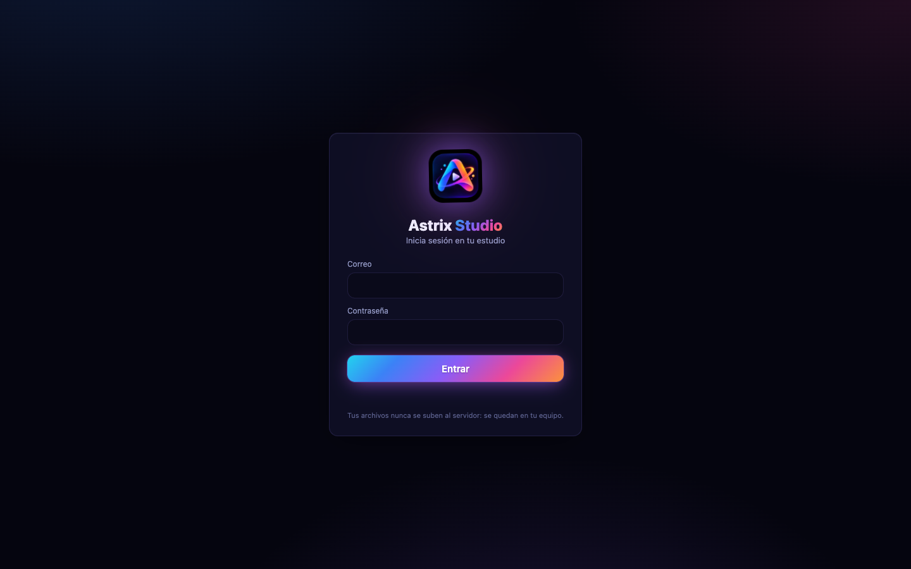 **Inicio de sesión** | |

> La animación de la flor de las capturas la generó el propio asistente (Claude Code) a partir de una frase. Las métricas del tablero UTM y los usuarios son **datos de demostración**.

## Funciones

### Animación y vectores
- **Formato `.moho`:** abre y guarda proyectos `.moho` (ZIP con JSON), con mallas, curvas, estilos, grupos, switch, cámara, huesos (atado de puntos, atado de capa y flexi) y keyframes con 12 tipos de interpolación.
- **Herramientas tipo Illustrator:**
  - Pluma, lápiz, rectángulo y elipse.
  - Selección por área con caja de transformación.
  - Puntos de esquina o suaves.
  - Relleno y trazo.
  - Importar y exportar **SVG**.
- **Animación:** rotar y mover huesos, crear huesos, transformar capas, papel cebolla, deshacer y rehacer.

### Edición de video
- **Línea de tiempo de pistas:** mover, recortar y cortar clips, con fundidos de entrada y salida.
- **Medios:** importar video, audio e imágenes. El audio del video va en su propia pista, con forma de onda.
- **Efectos por capa:** opacidad, desenfoque, 14 modos de fusión y ajustes de color.
- **Exportación:** MP4 o WebM con audio, PNG y SVG.
- **Formatos:** horizontal 16:9, corto vertical 9:16 y cuadrado 1:1, con un interruptor rápido.

### Asistente de IA (estilo Firefly)
- **Vector SVG y Animación** con Claude (Claude Code CLI o Claude API). Las partes llegan como grupos animables y el movimiento como keyframes nativos.
- **Animar capas existentes** describiendo el movimiento.
- **Imagen y video** con fal.ai: Seedance 2.0, Seedance 2.0 Fast, Seedance 1.0 Pro, FLUX y Recraft V3, o cualquier otro modelo por su ID.
- **Voz:** narración y efectos de sonido con **ElevenLabs**.
- **Clonar video:** solo videos animados. Detecta si el video es animado y lo recrea como vectores siguiendo el movimiento medido en los fotogramas.
- **Referencias multimodales:** el frame actual o una imagen.

### Investigación y medición
- **Investigación de tendencias** con Apify (TikTok, Instagram Reels, Facebook Reels y Posts, YouTube y Shorts). Calcula métricas normalizadas y engagement. **Claude analiza** los ganchos, formatos y duraciones que funcionan y propone ideas que se convierten en animaciones con un clic.
- **Medición UTM:**
  - Un enlace corto rastreable por video (`/r/CODIGO`).
  - Clics totales y únicos, por día, por plataforma y por dispositivo.
  - CTR sobre las vistas.
  - Exclusión de bots y exportación a CSV.

### Cuentas
- **Estudios multitenant aislados**, con roles Propietario, Administrador, Editor y Solo lectura, en **MariaDB**.
- **Contraseñas** cifradas con scrypt y cambio obligatorio en el primer acceso.
- **Sesiones** en cookie `HttpOnly`, con límite de intentos de login.

## Privacidad: tus archivos se quedan en tu equipo

- Videos, imágenes, audio y proyectos **nunca se guardan en el servidor ni en la base de datos**. La base solo guarda usuarios, estudios, sesiones y enlaces UTM.
- Al clonar un video, el navegador extrae los fotogramas y solo esas imágenes van a Claude. Si pasan por una carpeta temporal, se borra al terminar.
- Los proveedores de IA que uses (Anthropic, fal, ElevenLabs, Apify) reciben lo que procesan.

## Instalación

Requisitos: **Node.js 20+** (probado con 24), **MariaDB 10.6+** (probado con 12.3) y Chrome o Edge reciente.

```bash
git clone https://github.com/<tu-usuario>/astrix-studio.git
cd astrix-studio/server
npm install
```

Crea la base de datos y su usuario:

```sql
CREATE DATABASE moho_studio CHARACTER SET utf8mb4 COLLATE utf8mb4_unicode_ci;
CREATE USER 'moho_studio'@'localhost' IDENTIFIED BY 'una-contraseña-segura';
GRANT ALL PRIVILEGES ON moho_studio.* TO 'moho_studio'@'localhost';
```

Copia `server/.env.example` como `server/.env` y rellena `DB_PASSWORD` y las claves que vayas a usar. Después arranca:

```bash
npm start
```

Abre **http://127.0.0.1:8765**. En el primer arranque se crean las tablas y un administrador, con sus credenciales en `server/CREDENCIALES_ADMIN.txt`. Al entrar te pedirá cambiar la contraseña; después borra ese archivo.

### Claves opcionales (`server/.env`)

| Variable | Para qué |
|---|---|
| *(ninguna)* | Claude Code usa tu sesión del CLI (`claude auth login`) |
| `ANTHROPIC_API_KEY` | Claude API (`claude-opus-5-5`) |
| `FAL_KEY` | Seedance, FLUX, Recraft y otros modelos de fal.ai |
| `ELEVENLABS_API_KEY` | Voces y efectos de sonido |
| `APIFY_TOKEN` | Investigación de contenido |
| `PUBLIC_BASE_URL` | Dominio público para que los enlaces `/r/CODIGO` funcionen en redes |

## Estructura

```
index.html, login.html, style.css   Interfaz
js/        render.js (motor de render Moho), anim.js (keyframes), app.js (editor),
           ai.js (asistente IA), research.js (Apify), utm.js, account.js, svg.js, clips.js…
server/    server.mjs (HTTP, IA, fal, Apify), routes.mjs (cuentas, UTM, ElevenLabs), db.mjs (MariaDB)
docs/      documentación y capturas
scripts/   build-samples.mjs (índice opcional de ejemplos de una instalación propia de Moho)
```

## Documentación

- [Generación con IA](docs/GENERACION_IA.md)
- [Cuentas, UTM, voz, clonación y privacidad](docs/CUENTAS_UTM_Y_PRIVACIDAD.md)
- [Notas de interoperabilidad del formato `.moho`](docs/INGENIERIA_INVERSA.md)

## Aviso

Astrix Studio es un proyecto independiente. **No está afiliado ni respaldado por Smith Micro Software ni por Lost Marble.** "Moho" es una marca de sus respectivos dueños. Este repositorio no incluye código, ejecutables ni recursos de Moho. La compatibilidad con archivos `.moho` se basa en el estudio del formato de archivo con fines de interoperabilidad.
